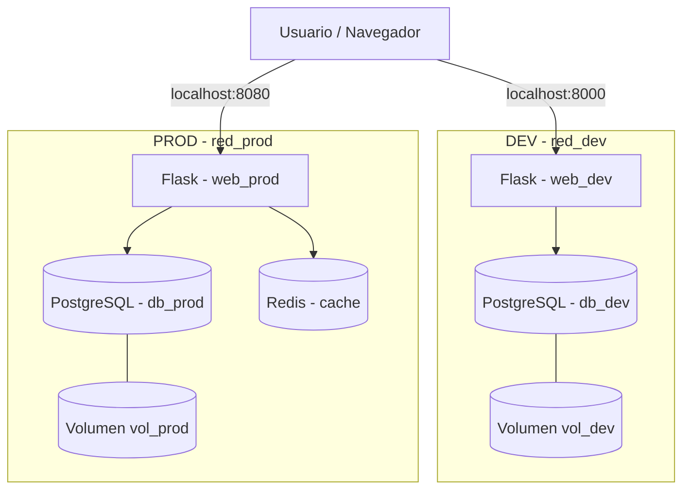

## Guía de instalación y ejecución paso a paso

### 1. Requisitos previos

Para ejecutar la práctica es necesario disponer de:

- Docker Desktop instalado y en ejecución.
- Docker Compose (incluido en Docker Desktop).
- Make instalado para utilizar las órdenes del Makefile.
- Git para descargar el repositorio.

La aplicación utiliza Python y Flask, pero no es necesario instalarlos en el equipo, ya que se ejecutan dentro de contenedores Docker.

### 2. Descargar el proyecto

Clonar el repositorio desde GitHub:

```bash
git clone https://github.com/2spoky4me/Redes_prac1.git
cd Redes_prac1
```

Todas las órdenes siguientes deben ejecutarse desde la carpeta que contiene el archivo `Makefile`.

### 3. Configurar las variables de entorno

Antes de iniciar los contenedores, es necesario crear dos archivos en la raíz del proyecto:

- `.env.dev`: configuración del entorno de desarrollo.
- `.env.prod`: configuración del entorno de producción.

Estos archivos no están incluidos en GitHub por seguridad, ya que contienen las credenciales de la base de datos.

**Ejemplo de `.env.dev`:**

```env
APP_ENV=dev
WEB_PORT=8000

POSTGRES_USER=user_db
POSTGRES_PASSWORD=CAMBIAR_PASSWORD_DEV
POSTGRES_DB=uprac1_db

DB_HOST=db_dev
DB_PORT=5432
DB_USER=user_db
DB_PASSWORD=CAMBIAR_PASSWORD_DEV
DB_NAME=uprac1_db
```

**Ejemplo de `.env.prod`:**

```env
APP_ENV=prod
WEB_PORT=8080

POSTGRES_USER=user_db
POSTGRES_PASSWORD=CAMBIAR_PASSWORD_PROD
POSTGRES_DB=uprac1_db

DB_HOST=db_prod
DB_PORT=5432
DB_USER=user_db
DB_PASSWORD=CAMBIAR_PASSWORD_PROD
DB_NAME=uprac1_db

REDIS_HOST=cache
REDIS_PORT=6379
```

Las contraseñas deben ser sustituidas por valores propios. En cada entorno, `POSTGRES_PASSWORD` y `DB_PASSWORD` deben coincidir.

### 4. Construir e iniciar los entornos

Para iniciar el entorno de desarrollo:

```bash
make up-dev
```

Este comando construye la imagen de Flask y levanta dos contenedores:

- `web_dev`: aplicación Flask.
- `db_dev`: base de datos PostgreSQL.

Para iniciar el entorno de producción:

```bash
make up-prod
```

Este comando levanta tres contenedores:

- `web_prod`: aplicación Flask.
- `db_prod`: base de datos PostgreSQL.
- `cache`: servidor Redis.

Ambos entornos pueden funcionar simultáneamente, ya que utilizan puertos, redes y volúmenes separados.

### 5. Acceder a la aplicación

Una vez iniciados los contenedores, abrir las siguientes direcciones en el navegador:

| Funcionalidad | Desarrollo | Producción |
|---|---|---|
| Página principal | http://localhost:8000 | http://localhost:8080 |
| Formulario | http://localhost:8000/form | http://localhost:8080/form |
| Listado de registros | http://localhost:8000/list | http://localhost:8080/list |
| Estado de los servicios | http://localhost:8000/status | http://localhost:8080/status |
| Prueba de Redis | No disponible | http://localhost:8080/cache-test |

Desde el formulario se pueden introducir registros en PostgreSQL y consultarlos posteriormente desde el listado.

En producción, el listado utiliza Redis como sistema de caché.

### 6. Comprobar el estado de los contenedores

Para visualizar todos los contenedores:

```bash
make ps
```

Para consultar los contenedores de un entorno concreto:

```bash
make ps-dev
make ps-prod
```

Tras finalizar el arranque, los cinco contenedores deben aparecer con estado `healthy`.

También se puede comprobar el estado de los servicios desde el navegador mediante `/status`.

En desarrollo, PostgreSQL debe estar conectado. En producción deben estar conectados tanto PostgreSQL como Redis.

### 7. Detener los entornos

Para detener y eliminar los contenedores de desarrollo sin borrar sus datos:

```bash
make down-dev
```

Para producción:

```bash
make down-prod
```

Para detener ambos entornos:

```bash
make down
```

Estos comandos conservan los volúmenes, por lo que los registros de PostgreSQL estarán disponibles al volver a iniciar los contenedores.

### 8. Eliminar completamente los recursos

Para eliminar los contenedores, las redes y los volúmenes gestionados por ambos entornos:

```bash
make clean
```

**Advertencia:** este comando elimina los volúmenes de PostgreSQL y, por tanto, los registros almacenados. Debe utilizarse únicamente cuando se desee reiniciar los datos de la práctica.

## Descripción de los entornos DEV y PROD

La práctica implementa dos entornos independientes mediante Docker Compose: **desarrollo (DEV)** y **producción (PROD)**.

Ambos utilizan la misma aplicación web desarrollada con Python y Flask, conectada a una base de datos PostgreSQL. La principal diferencia es que producción incorpora Redis para almacenar temporalmente los resultados de determinadas consultas y reducir los accesos a la base de datos.

### Entorno de desarrollo (DEV)

El entorno DEV está diseñado para probar el funcionamiento básico de la aplicación y su conexión con PostgreSQL.

Está formado por dos contenedores:

- **web_dev:** ejecuta la aplicación Flask y permite acceder mediante el puerto `8000`.
- **db_dev:** ejecuta PostgreSQL 16 y almacena los registros introducidos mediante los formularios.

**Características principales:**

- Acceso desde `http://localhost:8000`.
- Red interna Docker `red_dev`.
- Volumen persistente `vol_dev` para almacenar los datos de PostgreSQL.
- Comunicación entre Flask y PostgreSQL mediante la red interna.
- Consultas directas a PostgreSQL, sin utilizar Redis.
- Endpoint `/status` para comprobar la conexión con la base de datos.
- Healthchecks para verificar el estado de los contenedores.

La base de datos no publica ningún puerto hacia el exterior; únicamente la aplicación web es accesible desde el equipo anfitrión.

### Entorno de producción (PROD)

El entorno PROD incorpora Redis como sistema de caché para mejorar el acceso a los registros almacenados en PostgreSQL.

Está formado por tres contenedores:

- **web_prod:** ejecuta la aplicación Flask y permite acceder mediante el puerto `8080`.
- **db_prod:** ejecuta PostgreSQL 16 y almacena los registros de producción.
- **cache:** ejecuta Redis 7 y mantiene en memoria los resultados de las consultas cacheadas.

**Características principales:**

- Acceso desde `http://localhost:8080`.
- Red interna Docker `red_prod`.
- Volumen persistente `vol_prod` para los datos de PostgreSQL.
- Comunicación interna entre Flask, PostgreSQL y Redis.
- Caché Redis aplicada a las consultas del listado `/list`.
- Invalidación de la caché al insertar nuevos registros.
- Ruta `/cache-test` para comprobar el funcionamiento de Redis mediante un contador de visitas.
- Endpoint `/status` para verificar las conexiones con PostgreSQL y Redis.
- Healthchecks para supervisar los tres contenedores.

En producción, la primera consulta a `/list` obtiene los registros desde PostgreSQL (**MISS**) y guarda el resultado en Redis. Las siguientes consultas recuperan los datos de Redis (**HIT**). Al insertar un nuevo registro, se invalida la caché para que la próxima consulta obtenga la información actualizada.

PostgreSQL y Redis no publican sus puertos hacia el exterior.

### Comparación entre entornos

| Característica | DEV | PROD |
|---|---|---|
| Aplicación | Flask | Flask |
| Puerto web | 8000 | 8080 |
| Base de datos | PostgreSQL 16 | PostgreSQL 16 |
| Redis | No | Sí, Redis 7 |
| Contenedores | 2 | 3 |
| Red Docker | `red_dev` | `red_prod` |
| Volumen PostgreSQL | `vol_dev` | `vol_prod` |
| Persistencia de datos | Sí | Sí |
| Healthchecks | Sí | Sí |
| Caché en `/list` | No | Sí |

### Independencia de los entornos

DEV y PROD utilizan redes, volúmenes y bases de datos independientes. Por tanto, los registros introducidos en un entorno no aparecen en el otro.

Ambos pueden ejecutarse simultáneamente sin conflictos, y la detención o eliminación de los contenedores de un entorno no implica eliminar los datos del otro.

Esta separación permite probar cambios en desarrollo sin modificar la información almacenada en producción.

## Diagrama de arquitectura del servicio



## Resultados de las pruebas y verificaciones

Se han realizado las siguientes pruebas para comprobar el correcto funcionamiento de ambos entornos.

| Prueba | Resultado |
|---|---|
| Despliegue de DEV mediante `make up-dev` | Correcto |
| Despliegue de PROD mediante `make up-prod` | Correcto |
| Cinco contenedores con estado `healthy` | Correcto |
| Funcionamiento de los formularios | Correcto |
| Inserción y consulta de registros en PostgreSQL | Correcto |
| Independencia de las bases de datos DEV y PROD | Correcto |
| Persistencia de datos al eliminar y recrear PostgreSQL en DEV | Correcto |
| Persistencia de datos al eliminar y recrear PostgreSQL en PROD | Correcto |
| Detección de fallos de PostgreSQL mediante `/status` | Correcto |
| Detección de desconexión y recuperación de Redis mediante `/status` | Correcto |
| Caché Redis: primera consulta MISS y siguientes HIT | Correcto |
| Invalidación de la caché al insertar nuevos registros | Correcto |

### Prueba de persistencia

Se eliminaron los contenedores PostgreSQL de DEV y PROD mediante `make remove-db-dev` y `make remove-db-prod`.

Posteriormente, se recrearon mediante `make recreate-db-dev` y `make recreate-db-prod`.

**Resultado:** los registros introducidos previamente continuaban disponibles gracias a los volúmenes persistentes.

### Prueba de disponibilidad de servicios

Se comprobó que el endpoint `/status` detectaba la desconexión de PostgreSQL y Redis, así como su recuperación al volver a iniciar los servicios.

**Resultado:** el estado de las conexiones se actualizaba correctamente.

### Prueba de caché Redis

En el entorno PROD se comprobó el siguiente comportamiento:

1. Primera consulta a `/list`: **PostgreSQL (MISS)**.
2. Segunda consulta: **Redis (HIT)**.
3. Inserción de un nuevo registro: invalidación de la caché.
4. Nueva consulta: **PostgreSQL (MISS)**.
5. Consulta posterior: **Redis (HIT)**.

**Resultado:** el sistema de caché funciona correctamente y evita consultas innecesarias a PostgreSQL.


Funcionamiento de los healthchecks

En esta práctica se utilizan healthchecks de Docker para comprobar automáticamente el estado de los cinco contenedores.

Las comprobaciones están definidas en los archivos docker-compose.dev.yml y docker-compose.prod.yml.

1. Healthcheck de PostgreSQL (db_dev y db_prod)

Se utiliza el comando pg_isready, que comprueba si PostgreSQL está preparado para aceptar conexiones.

Si responde correctamente, Docker considera el contenedor healthy. Si deja de responder durante varias comprobaciones consecutivas, pasa a unhealthy.

2. Healthcheck de Flask (web_dev y web_prod)

Los contenedores web ejecutan un pequeño script de Python que realiza una petición HTTP al endpoint /status.

DEV: comprueba que db_connected sea true.

PROD: comprueba que tanto db_connected como cache_connected sean true.

Si las condiciones se cumplen, el healthcheck termina correctamente. En caso contrario, devuelve un error y Docker puede marcar el contenedor como unhealthy.

3. Healthcheck de Redis (cache)

Redis utiliza el comando:

redis-cli ping

Si Redis funciona, responde PONG, indicando que está disponible. Si no responde, el healthcheck falla.

4. Cómo se muestran los resultados

Para consultar el estado de los contenedores ejecutamos:

make ps

Docker muestra el estado junto a cada contenedor:

health: starting: todavía se están realizando las comprobaciones iniciales.

healthy: las comprobaciones se superan correctamente.

unhealthy: las comprobaciones están fallando.

Además, la aplicación dispone del endpoint /status, que muestra las conexiones con los servicios:

DEV: http://localhost:8000/status

{
  "db_connected": true,
  "cache_connected": false
}

PROD: http://localhost:8080/status

{
  "db_connected": true,
  "cache_connected": true
}

En DEV, cache_connected aparece como false porque no se utiliza Redis.

## Instrucciones de uso del Makefile

El Makefile permite gestionar los entornos DEV y PROD mediante comandos sencillos, sin necesidad de escribir las instrucciones completas de Docker Compose.

Los comandos deben ejecutarse desde la carpeta raíz del proyecto.

| Comando | Función |
|---|---|
| `make build` | Construye las imágenes de ambos entornos. |
| `make up-dev` | Inicia DEV (Flask + PostgreSQL). |
| `make up-prod` | Inicia PROD (Flask + PostgreSQL + Redis). |
| `make ps` | Muestra el estado de todos los contenedores. |
| `make ps-dev` / `make ps-prod` | Muestra los contenedores de cada entorno. |
| `make down-dev` / `make down-prod` | Detiene y elimina un entorno conservando los datos. |
| `make down` | Detiene y elimina ambos entornos conservando los datos. |
| `make remove-db-dev` / `make remove-db-prod` | Elimina el contenedor PostgreSQL sin borrar su volumen. |
| `make recreate-db-dev` / `make recreate-db-prod` | Recrea PostgreSQL reutilizando el volumen existente. |
| `make stop-cache` | Detiene Redis para comprobar la detección de fallos. |
| `make start-cache` | Vuelve a iniciar Redis. |
| `make clean` | Elimina los entornos y sus volúmenes. **Se pierden los datos almacenados.** |

### Ejemplo de ejecución

Para iniciar ambos entornos:

```bash
make up-dev
make up-prod
make ps
```

Una vez iniciados, las aplicaciones están disponibles en:

- **DEV:** http://localhost:8000
- **PROD:** http://localhost:8080

Para detener ambos entornos sin perder los datos:

```bash
make down
```